# Report

## Part 0

### Q1

| 項目 | 規格 |
| --- | --- |
| GPU Name | NVIDIA GeForce RTX 5090 |
| Compute capability | 12.0 |
| SM count | 170 |
| Peak FP32 GFLOP/s（Boost clock） | 104,800 GFLOP/s |
| Peak DRAM GB/s | 1,792 GB/s |

以 [TechPowerUp RTX 5090 規格頁](https://www.techpowerup.com/gpu-specs/geforce-rtx-5090.c4216)為參考，計算所需的規格為 21,760 個 CUDA cores、2,407 MHz（2.407 GHz）的 Boost clock、28 Gbps per pin 的 GDDR7 記憶體資料率，以及 512-bit 的記憶體匯流排。Compute capability 依據 [NVIDIA 官方列表](https://developer.nvidia.com/cuda/gpus)填入 12.0。

**FP32 理論峰值：**

$$
\begin{aligned}
P_{\mathrm{FP32}} &= 2 \times \text{CUDA cores} \times \text{Boost clock (GHz)} \\
&= 2 \times 21{,}760 \times 2.407 \\
&= 104{,}752.64\ \text{GFLOP/s} \\

\end{aligned}
$$

**DRAM 理論峰值頻寬：**

$$
\begin{aligned}
BW_{\mathrm{DRAM}} &= \text{Memory data rate (Gbps per pin)} \times \text{Bus width (bits)} \div 8 \\
&= 28 \times 512 \div 8 \\
&= 1{,}792\ \text{GB/s}.
\end{aligned}
$$

綜上所述，網頁上的 peak 數值和公式的一致。

### Q2

Roofline 的 ridge point 是計算峰值與 DRAM 頻寬峰值的比值。使用 Q1 規格表的數值：

$$
I_{\mathrm{ridge}} = \frac{P_{\mathrm{FP32}}}{BW_{\mathrm{DRAM}}}
= \frac{104{,}800\ \text{GFLOP/s}}{1{,}792\ \text{GB/s}}
\approx 58.48\ \text{FLOP/byte}.
$$

對於 FP32 SGEMM，每個元素占 4 bytes。在 A、B 各從 DRAM 讀取一次，C 寫入一次的假設下，總運算量為 $2MNK$ FLOPs，總 DRAM 傳輸量為 $4(MK+KN+MN)$ bytes。因此當 $M=N=K=4096$ 時，算術強度為：

$$
\begin{aligned}
I_{\mathrm{SGEMM}} &= \frac{2MNK}{4(MK+KN+MN)} \\
&= \frac{2\times4096^3}{4\times3\times4096^2} \\
&= \frac{4096}{6} \approx 682.67\ \text{FLOP/byte}.
\end{aligned}
$$

由於 $682.67 > 58.48$，此算術強度位於 ridge point 右側，因此在題目的理想 DRAM 存取假設下，這個大小的 SGEMM 應為 **compute-bound**，其 roofline 上限由 FP32 計算峰值決定。

## Part 1

### Q1

naive benchmark 結果

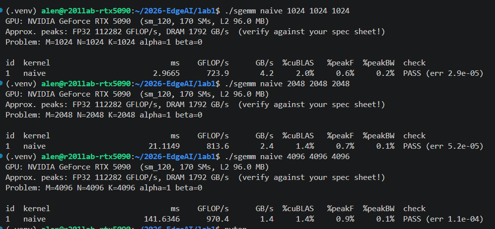

cublas benchmark 結果

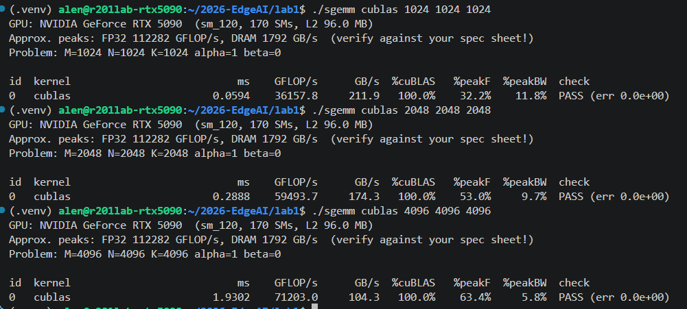

### Q2

naive kernel 的瓶頸是 **memory access，主要集中在 L1/TEX 的存取處理**。在 $M=N=K=2048$ 的 Nsight Compute 結果中，Memory Throughput 達 **95.79%**，明顯比 Compute (SM) Throughput 的 **11.61%** 更接近峰值。各層的 throughput 分別為 L1/TEX **99.38%**、L2 **2.96%**、DRAM **0.14%**，顯示 L1/TEX 已接近飽和，而 DRAM 頻寬仍有大量餘裕。

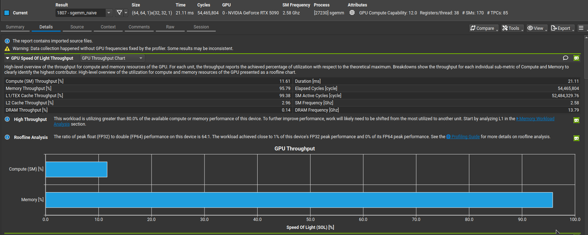

Memory Workload Analysis 顯示 L1/TEX hit rate 為 **99.23%**、L2 hit rate 為 **97.81%**，實際 DRAM throughput 僅 **2.39 GB/s**。大量資料由快取服務，但高命中率並未消除記憶體存取的處理成本。圖中也指出 global-load 存取模式不佳：每個 32-byte sector，平均每個 thread 僅使用其中 **4 bytes**。naive 將相鄰 lanes 對應到不同 row，使同一個 warp 對 A 的讀取位址相差 K 個 floats，造成分散的存取，增加 L1/TEX 處理負擔。

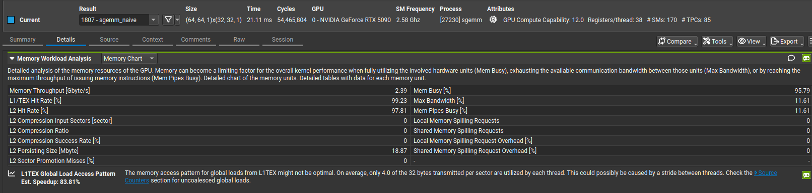

Warp State Statistics 進一步顯示，主要 stall 為 **LG Throttle**，每 issued instruction 平均約有 **201.5 cycles** 花在此等待，約占總平均 **225.69 cycles** 的 **89.3%**。這表示 warp 因 local/global memory 指令佇列已滿而無法繼續發出指令，與 L1/TEX 接近飽和的結果一致。因此，naive 的效能受記憶體存取處理能力限制，FP32 運算能力尚未充分發揮。

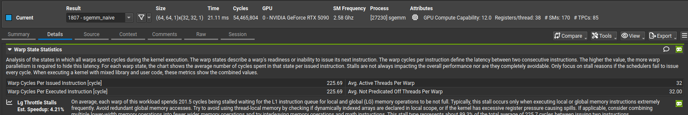

FP32 峰值達成率以實際 GFLOP/s 除以 Part 0 的規格表峰值計算。Q1 的 2048³ benchmark 為 **813.6 GFLOP/s**，因此：

$$
\frac{P_{\mathrm{naive}}}{P_{\mathrm{FP32,peak}}}\times100\%
=\frac{813.6}{104{,}800}\times100\%
\approx\boxed{0.776\%}.
$$

因此，naive 僅達 GPU FP32 理論峰值的 **0.776%**。

## Part2

### Q1
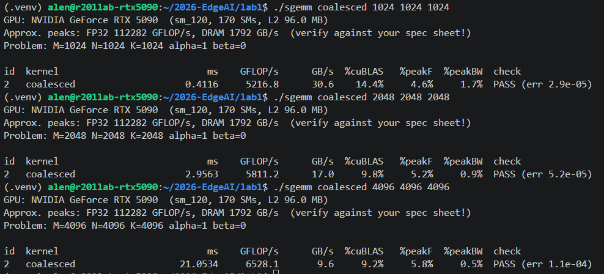

### Q2

coalesced 的加速來自 **warp 內的記憶體存取合併（coalescing）**。兩版對每個輸出元素執行相同的 FLOPs，並以相同的 k 順序讀取 A、B；改變的是相鄰 lanes 對應的輸出座標，以及同一條載入指令所存取的位址分布。

naive 的 `threadIdx.x` 對應 row，因此同一 warp 的 32 個 lanes 在固定 k 時，讀取的 A 位址相差 K 個 floats，B 則讀取相同位址。coalesced 將 `threadIdx.x` 改為對應 col，使同一 warp 讀取相同的 A 元素，以及連續的 32 個 B 元素。連續位址可合併為較少的 memory sectors，降低 L1/TEX 的存取處理負擔。

2048³ 的 Nsight Compute **Global Load** 數據如下：

| 指標 | naive | coalesced |
| --- | ---: | ---: |
| Requests | 537,001,984 | 537,001,984 |
| Sectors | 8,862,564,352 | 1,342,701,568 |
| Sectors/Req | 16.50 | 2.50 |

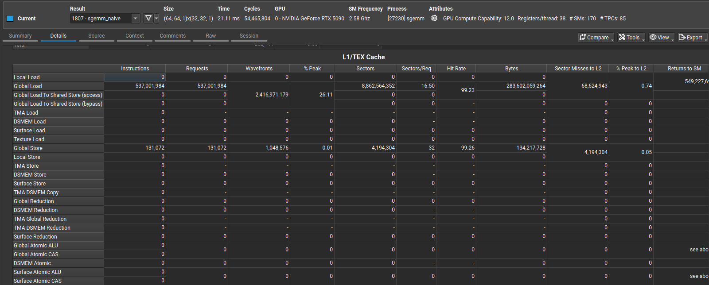

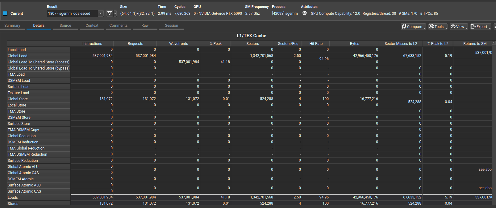

兩版的 requests 數相同，但 coalesced 的 sectors/request 從 **16.50 降至 2.50**，每個 request 所需處理的 sectors 減為約 **1/6.6**。以主迴圈的 A、B 載入解釋：naive 的分散 A 讀取需要 32 個 sectors，同址 B 讀取需要 1 個，平均為 $(32+1)/2=16.5$；coalesced 的同址 A 讀取需要 1 個 sector，連續 32 個 FP32 B 元素占 128 bytes，需要 4 個 sectors，平均為 $(1+4)/2=2.5$。同址讀取的合併與 B 的連續存取，共同減少了記憶體交易。

Warp State Statistics 也顯示存取壓力降低：LG Throttle 從 Part 1 naive 的約 **201.5 cycles／issued instruction** 降至 coalesced 的約 **18.3 cycles／issued instruction**，總平均 Warp Cycles Per Issued Instruction 則由 **225.69 降至 32.80**。coalescing 減少每次載入需要處理的 sectors，縮短記憶體指令佇列造成的等待，因此即使 FLOPs 與邏輯載入量相同，kernel 仍明顯加速。

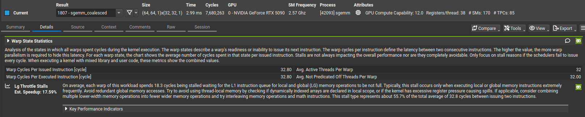

### Q3

**最忙的是 L1/TEX，重複讀取主要由 L1 快取服務，L1 miss 後再由 L2 快取服務。** Memory Workload Analysis 中，各層表格的 `% Peak` 如下：

| 記憶體層級 | 圖中表格的 % Peak |
| --- | ---: |
| L1/TEX（Loads） | 41.18% |
| L2（GPU Total） | 9.74% |
| DRAM／Device Memory（Total） | 0.96% |

L1/TEX 的負載最高，DRAM 則僅使用 **0.96%** 的峰值。上方摘要同時顯示 **L1/TEX hit rate 為 94.96%**、**L2 hit rate 為 97.74%**，說明絕大多數存取由快取服務。

雖然每個 A 元素在程式中被讀取 N 次，每個 B 元素被讀取 M 次，但這些是邏輯上的 global loads，並不代表每次都要從 DRAM 重新取回資料。同一 warp 對 A 的同址讀取會合併；後續對已快取資料的重複讀取主要命中 L1。L1 miss 的請求送往 L2，其中大多數再命中 L2，只有快取未命中的少部分請求需要到 DRAM。因此，**L1 與 L2 承擔了重複資料的供應，L1/TEX 也是最忙的記憶體層級**。

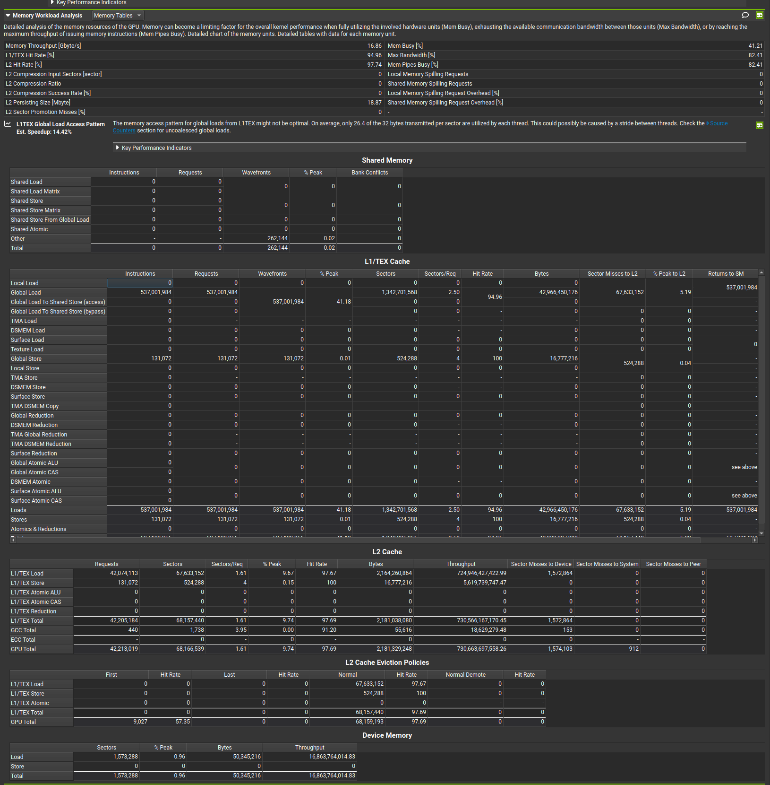

## Part3

### Q1

在 $M=N=K=2048$ 下，比較 smem16、smem32 與六組 reg2d，八組的 correctness 結果皆為 PASS。benchmark 如下，表格使用圖中 2048³ 的時間；registers/thread 與 static shared memory/block 取自 `make` 的編譯輸出，occupancy、warp stall 與 bank conflicts 則取自各組的 Nsight Compute 圖片。

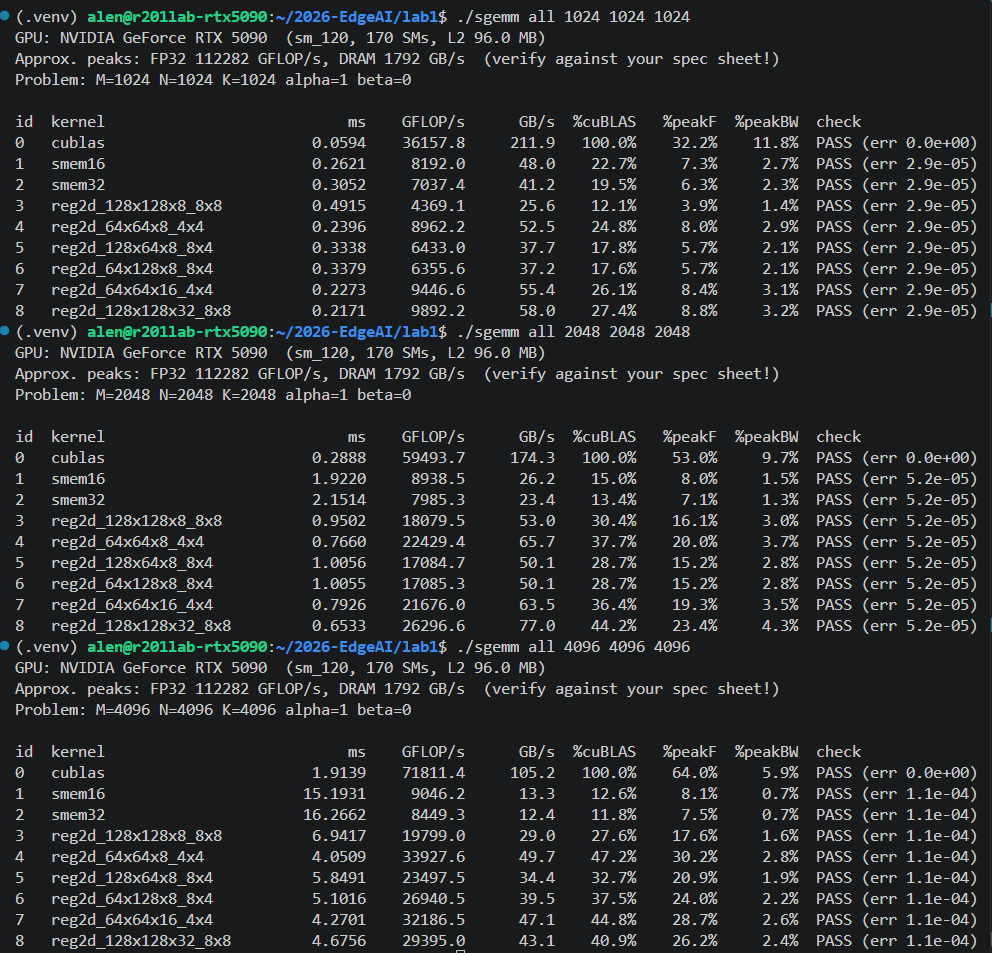

圖 3-1：Part 3 benchmark；以下實驗表與分析使用中間的 2048³ 結果。

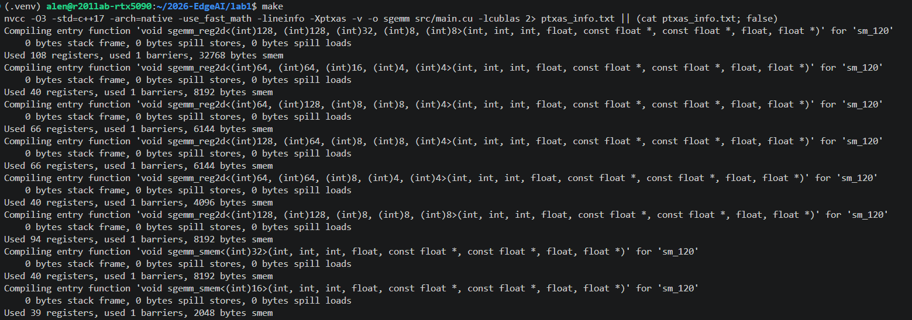

圖 3-2：八組 kernel 的 registers/thread 與 static shared memory/block。

**效能與資源表**

| Kernel | Benchmark time（ms） | Registers/thread | Static smem/block（bytes） | Theoretical occupancy | Achieved occupancy |
| --- | ---: | ---: | ---: | ---: | ---: |
| smem16 | 1.9220 | 39 | 2,048 | 100.00% | 97.47% |
| smem32 | 2.1514 | 40 | 8,192 | 66.67% | 66.51% |
| reg2d_128x128x8_8x8 | 0.9502 | 94 | 8,192 | 33.33% | 25.07% |
| reg2d_64x64x8_4x4 | 0.7660 | 40 | 4,096 | 100.00% | 99.05% |
| reg2d_128x64x8_8x4 | 1.0056 | 66 | 6,144 | 50.00% | 49.74% |
| reg2d_64x128x8_8x4 | 1.0055 | 66 | 6,144 | 50.00% | 49.63% |
| reg2d_64x64x16_4x4 | 0.7926 | 40 | 8,192 | 100.00% | 98.19% |
| **reg2d_128x128x32_8x8** | **0.6533** | 108 | 32,768 | 33.33% | 26.81% |

**等待與衝突表**

| Kernel | Dominant warp stall | Cycles／issued instruction | Shared-load bank conflicts | Shared-store bank conflicts |
| --- | --- | ---: | ---: | ---: |
| smem16 | MIO Throttle | 21.0 | 19,695 | 0 |
| smem32 | MIO Throttle | 21.7 | 0 | 4,443,919 |
| reg2d_128x128x8_8x8 | Long Scoreboard | 7.6 | 33,593,130 | 14,680,064 |
| reg2d_64x64x8_4x4 | Long Scoreboard | 11.2 | 0 | 29,360,128 |
| reg2d_128x64x8_8x4 | Long Scoreboard | 11.2 | 0 | 29,360,128 |
| reg2d_64x128x8_8x4 | Long Scoreboard | 10.3 | 0 | 14,680,064 |
| reg2d_64x64x16_4x4 | Long Scoreboard | 10.7 | 0 | 62,914,560 |
| reg2d_128x128x32_8x8 | Long Scoreboard | 2.9 | 33,580,890 | 65,033,435 |

Bank conflicts 分別使用 Shared Load 與 Shared Store 的計數；warp stall 數值採用 Warp State (All Cycles) 的 cycles／issued instruction。以下圖片依表格順序提供各組的量測證據。

**smem16（2048³）**

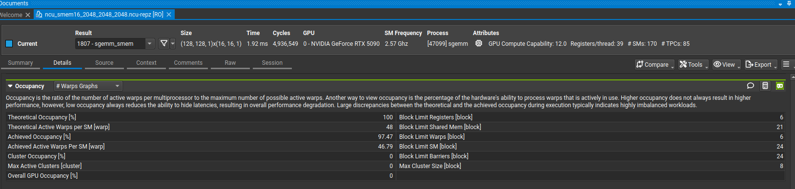

圖 3-3：smem16，2048³：理論與實測 occupancy，以及各項 Block Limit。

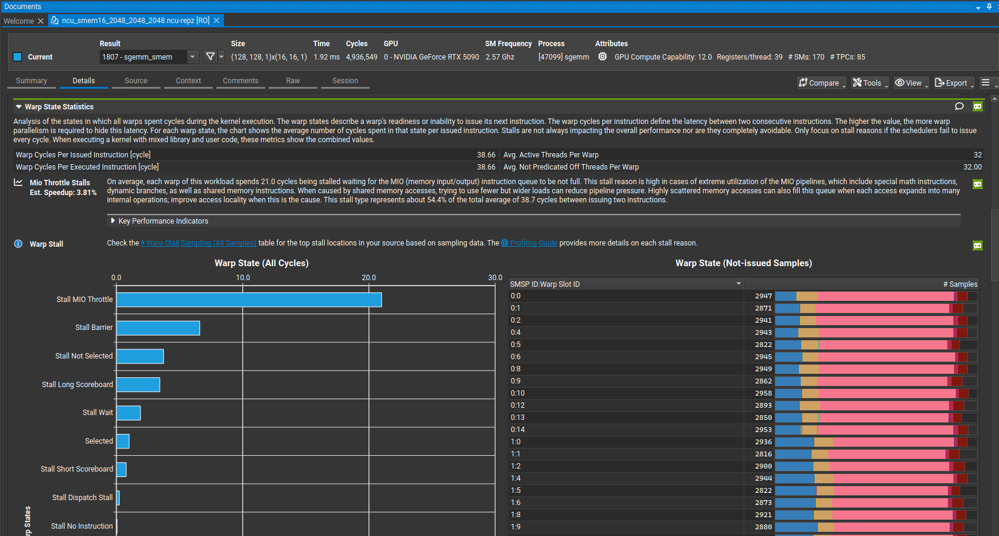

圖 3-4：smem16，2048³：主要 warp stall 為 MIO Throttle。

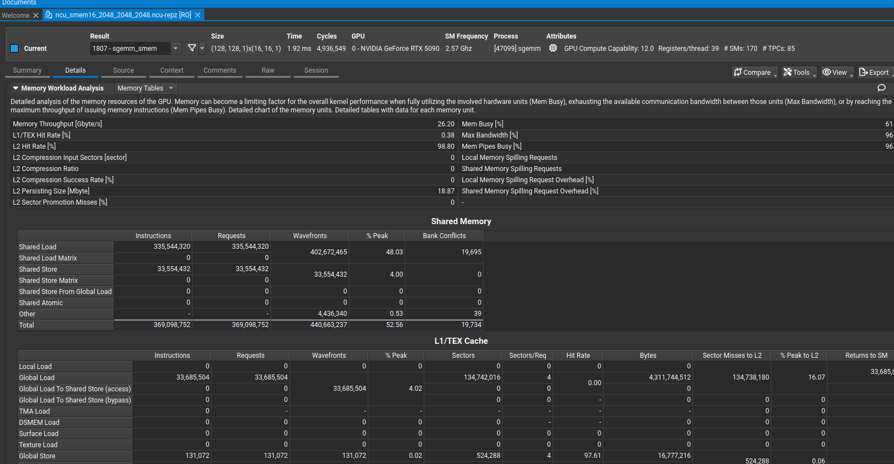

圖 3-5：smem16，2048³：shared-load／store bank conflicts。

**smem32（2048³）**

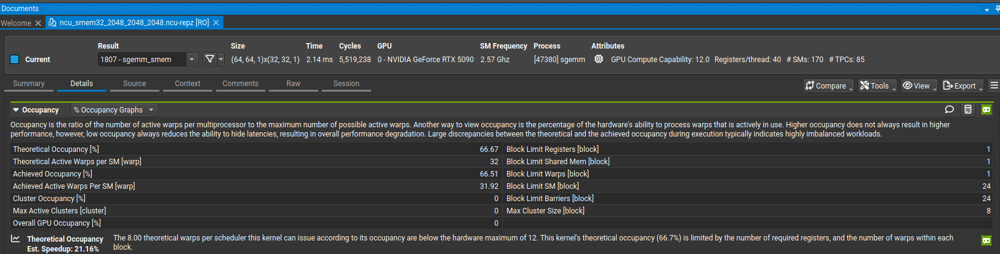

圖 3-6：smem32，2048³：理論與實測 occupancy，以及各項 Block Limit。

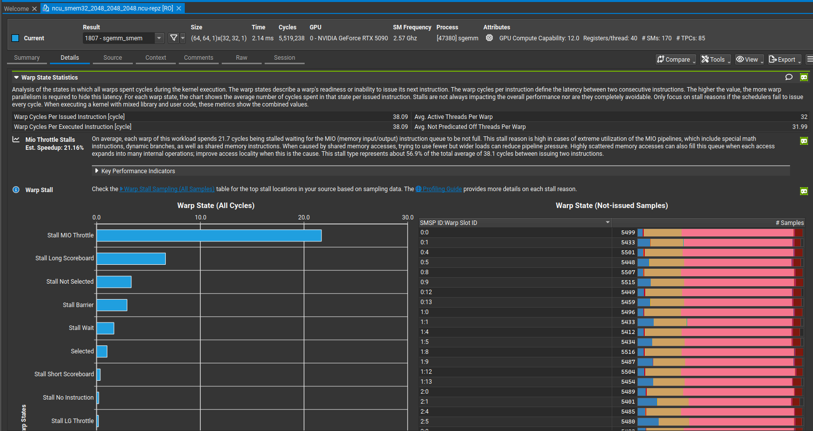

圖 3-7：smem32，2048³：主要 warp stall 為 MIO Throttle。

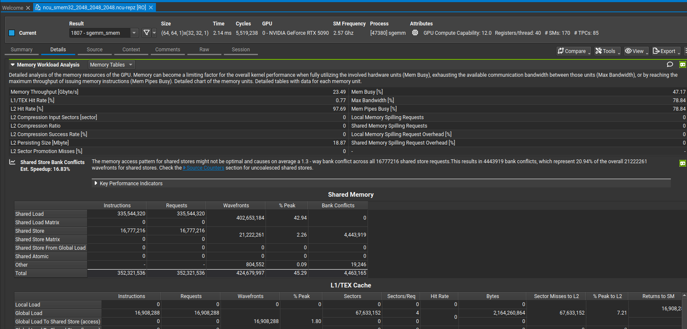

圖 3-8：smem32，2048³：shared-load／store bank conflicts。

**reg2d_128x128x8_8x8（2048³）**

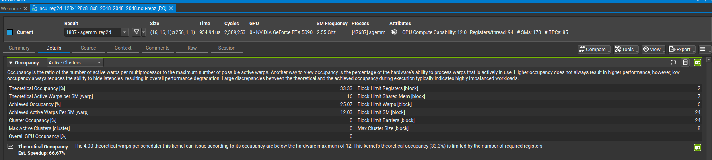

圖 3-9：reg2d_128x128x8_8x8，2048³：理論與實測 occupancy，以及各項 Block Limit。

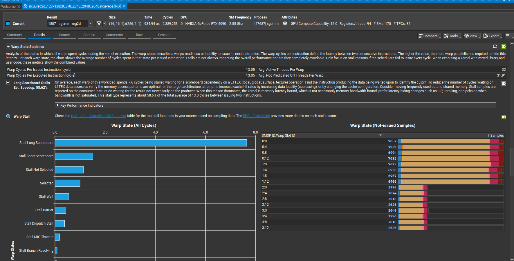

圖 3-10：reg2d_128x128x8_8x8，2048³：主要 warp stall 為 Long Scoreboard。

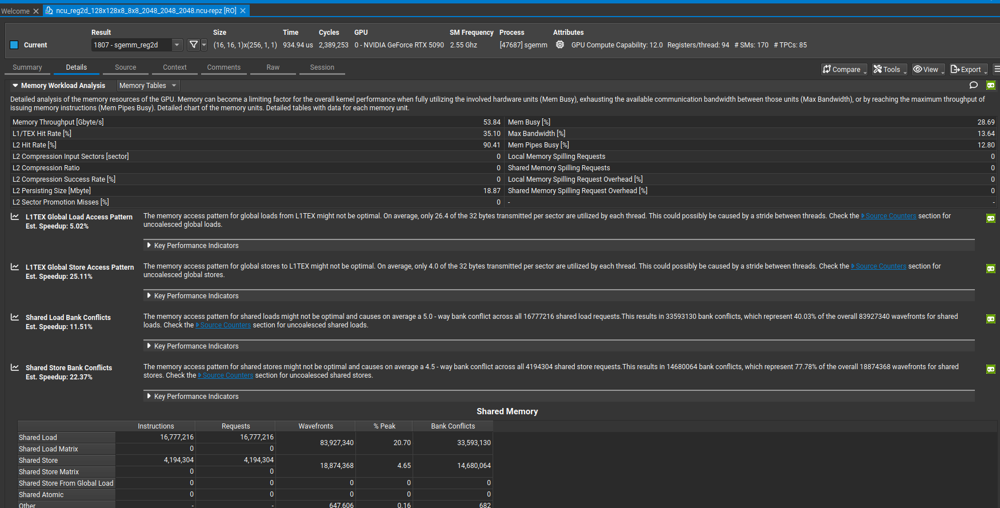

圖 3-11：reg2d_128x128x8_8x8，2048³：shared-load／store bank conflicts。

**reg2d_64x64x8_4x4（2048³）**

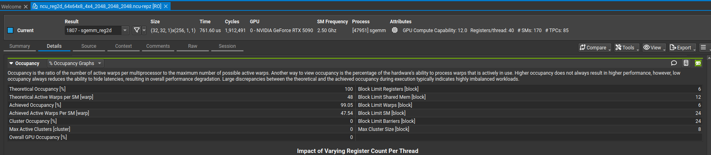

圖 3-12：reg2d_64x64x8_4x4，2048³：理論與實測 occupancy，以及各項 Block Limit。

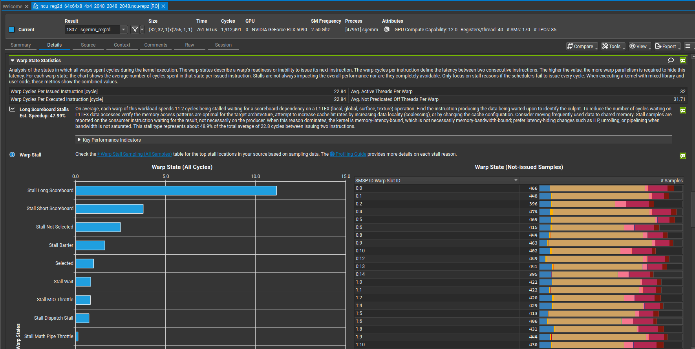

圖 3-13：reg2d_64x64x8_4x4，2048³：主要 warp stall 為 Long Scoreboard。

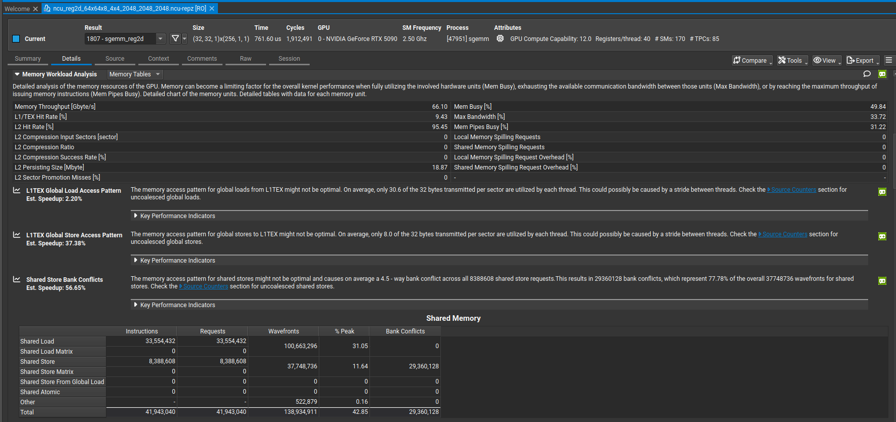

圖 3-14：reg2d_64x64x8_4x4，2048³：shared-load／store bank conflicts。

**reg2d_128x64x8_8x4（2048³）**

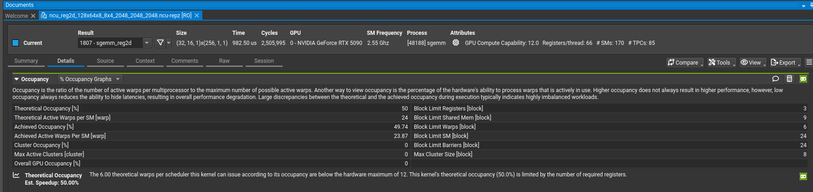

圖 3-15：reg2d_128x64x8_8x4，2048³：理論與實測 occupancy，以及各項 Block Limit。

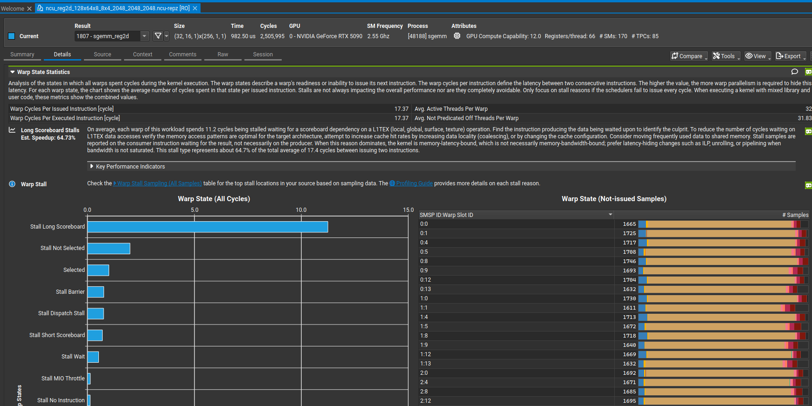

圖 3-16：reg2d_128x64x8_8x4，2048³：Long Scoreboard 與其他 warp stalls。

圖 3-17：reg2d_128x64x8_8x4，2048³：shared-load／store bank conflicts。

**reg2d_64x128x8_8x4（2048³）**

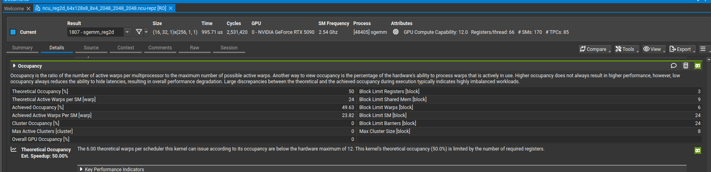

圖 3-18：reg2d_64x128x8_8x4，2048³：理論與實測 occupancy，以及各項 Block Limit。

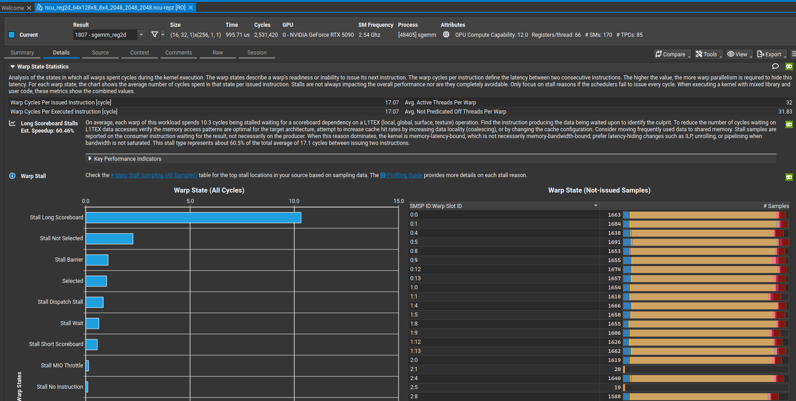

圖 3-19：reg2d_64x128x8_8x4，2048³：主要 warp stall 為 Long Scoreboard。

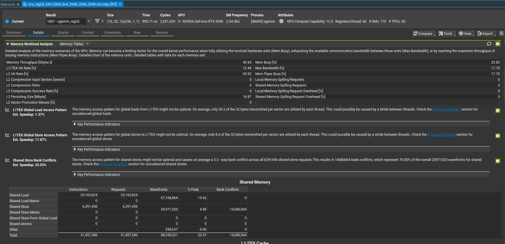

圖 3-20：reg2d_64x128x8_8x4，2048³：shared-load／store bank conflicts。

**reg2d_64x64x16_4x4（2048³）**

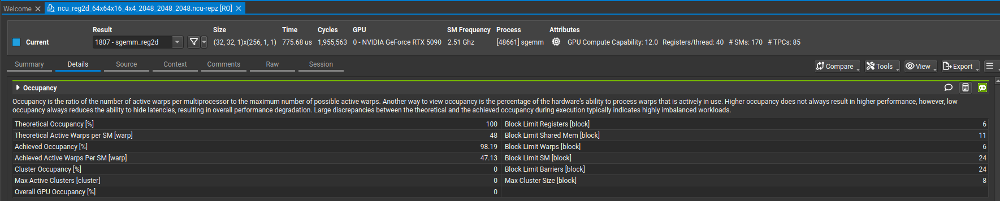

圖 3-21：reg2d_64x64x16_4x4，2048³：理論與實測 occupancy，以及各項 Block Limit。

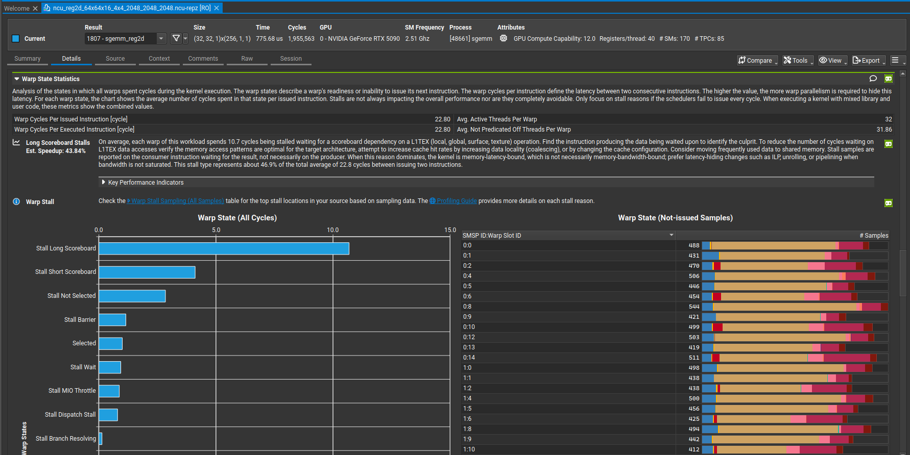

圖 3-22：reg2d_64x64x16_4x4，2048³：主要 warp stall 為 Long Scoreboard。

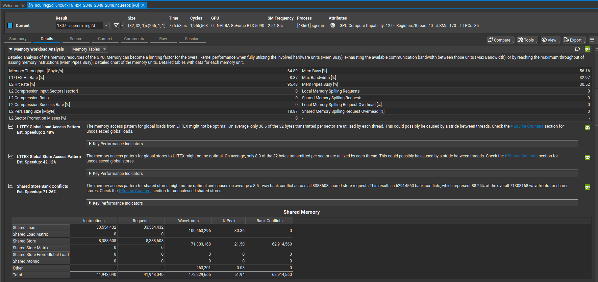

圖 3-23：reg2d_64x64x16_4x4，2048³：shared-load／store bank conflicts。

**reg2d_128x128x32_8x8（2048³）**

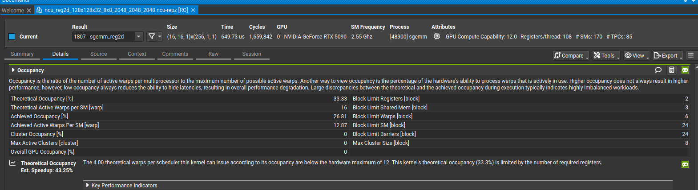

圖 3-24：reg2d_128x128x32_8x8，2048³：理論與實測 occupancy，以及各項 Block Limit。

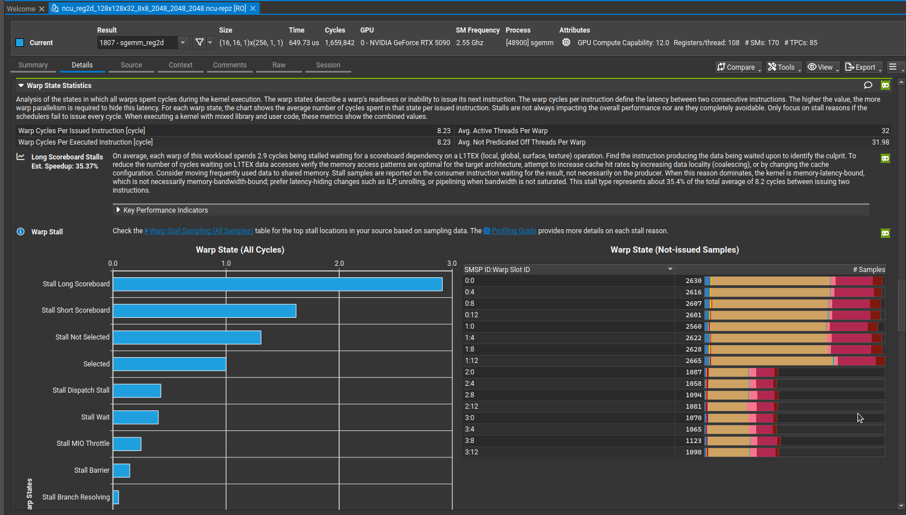

圖 3-25：reg2d_128x128x32_8x8，2048³：Long Scoreboard 與其他 warp stalls。

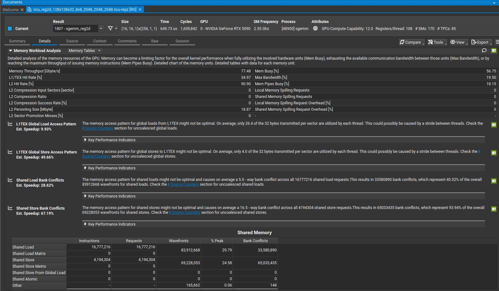

圖 3-26：reg2d_128x128x32_8x8，2048³：shared-load／store bank conflicts。

### Q2

在 3a 中，每個 thread 計算一個輸出元素。每個 k 從 shared memory 讀取一個 A 值與一個 B 值，完成一次 FMA，因此需要 **2 個 FP32 shared-memory 元素載入／FMA**。

在 3b 中，每個 thread 計算 TM×TN 個輸出。每個 k 先將 TM 個 A 值與 TN 個 B 值從 shared memory 載入 registers，再以 outer product 完成 TM×TN 次 FMA，因此：

$$
\text{shared loads/FMA}=\frac{TM+TN}{TM\cdot TN}.
$$

當 TM=TN=8 時，載入 8 個 A 與 8 個 B，共 16 個元素，即可完成 64 次 FMA：

$$
\frac{8+8}{8\times8}=\boxed{0.25\ \text{個 FP32 元素／FMA}}.
$$

相較 3a 的 2 個元素／FMA，shared-memory 載入需求降低 **8 倍**。每個 A register 值重用於八個輸出欄，每個 B register 值重用於八個輸出列，使更多 FMA 共用已載入的資料，降低 shared-memory 存取成本。這裡的載入量以 FP32 元素數計算。

Q1 的 benchmark 顯示，`reg2d_128x128x32_8x8` 為 **0.6533 ms**，相對 smem16 的 **1.9220 ms** 加速 **2.942×**，相對 smem32 的 **2.1514 ms** 加速 **3.293×**。register blocking 透過資料重用減少每次 FMA 的 shared-memory 需求，是 3b 提升效能的重要原因。

### Q3

最快的組態是 **`reg2d_128x128x32_8x8`**，時間 **0.6533 ms**；以 **`reg2d_128x64x8_8x4`** 作為 clearly slower 的比較組，其時間為 **1.0056 ms**。最快組態的加速比為：

$$
\text{Speedup}=\frac{1.0056}{0.6533}\approx\boxed{1.539\times}.
$$

兩組的資源與 profiler 數據如下，對應 Q1 的圖 3-2、3-15～3-17 與 3-24～3-26：

| 指標 | reg2d_128x64x8_8x4（Clearly slower） | reg2d_128x128x32_8x8（Fastest） |
| --- | ---: | ---: |
| Benchmark time | 1.0056 ms | 0.6533 ms |
| Registers/thread | 66 | 108 |
| Static smem/block | 6,144 bytes | 32,768 bytes |
| Theoretical occupancy | 50.00% | 33.33% |
| Achieved occupancy | 49.74% | 26.81% |
| Long Scoreboard（cycles／issued instruction） | 11.2 | 2.9 |
| Shared-load bank conflicts | 0 | 33,580,890 |
| Shared-store bank conflicts | 29,360,128 | 65,033,435 |

**資料重用增加。** TM/TN 從 8×4 變為 8×8，每個 k 的 FMA 從 32 次增至 64 次，shared-memory 元素載入量則從 12 個增至 16 個。每次 FMA 的載入需求因此由 $(8+4)/(8\times4)=0.375$ 降至 $(8+8)/(8\times8)=0.25$，降低 **三分之一**。較大的 register tile 讓每次 shared-memory 載入服務更多運算。

**迭代與同步減少。** BK 從 8 增至 32，使 K=2048 的 K-tile 迭代由 **256 次降至 64 次**。每輪有兩次 `__syncthreads()`，所以每 block 的同步次數由 **512 次降至 128 次**，減少 tile 切換與同步成本。

**資料相依等待減少。** Long Scoreboard 從 **11.2 降至 2.9 cycles／issued instruction**，顯示等待 L1/TEX 資料相依性的時間明顯縮短。這項改善與較低的載入需求、較少的 tile 迭代共同提升 kernel 效能。

**資源用量與 occupancy 的取捨。** 較大的 register tile 與 shared-memory tile，使 registers/thread 由 **66 增至 108**，static smem/block 由 **6,144 增至 32,768 bytes**。理論 occupancy 從 **50.00% 降至 33.33%**，實際 occupancy 從 **49.74% 降至 26.81%**，但 kernel 仍快 **1.539×**。資料重用與等待成本的改善帶來更高效能，也說明較高 occupancy 並不保證較快。

**Bank conflicts 的判讀。** 最快組態的 shared-load conflicts 為 **33,580,890**，shared-store conflicts 為 **65,033,435**，兩者都高於比較組的 **0／29,360,128**。這組實驗顯示，效能優勢來自資料重用、tile 迭代與等待成本的改善，即使 bank conflicts 增加，整體執行時間仍明顯縮短。

## Part4

### Q1

#### 方法與驗證結果

本部分依序使用 `reg2d_128x128x8_8x8 → custom_vec4 → custom_vec4_warptiling`，逐步加入兩項優化。第一步以 **float4** 一次搬移四個連續的 FP32 元素，降低搬移指令成本；第二步保留向量化載入，加入 **warp tiling**，重新安排 warp/lane 的輸出分工，改善 shared-memory 讀取與 C 寫回。

三個 kernel 均使用 BM=BN=128、BK=8、TM=TN=8。在 RTX 5090 執行 `bash scripts/grade.sh`，4096³ 的結果如下；計算時間與相對前一步加速比直接引用腳本輸出。

| Kernel | 4096³ 計算時間（ms） | 相對前一步加速比 |
| --- | ---: | ---: |
| reg2d_128x128x8_8x8 | 7.239 | — |
| custom_vec4 | 3.071 | 2.357× |
| custom_vec4_warptiling | 2.797 | 1.098× |

**`grade.sh` 的 correctness 與 sanitizer 檢查皆通過。**

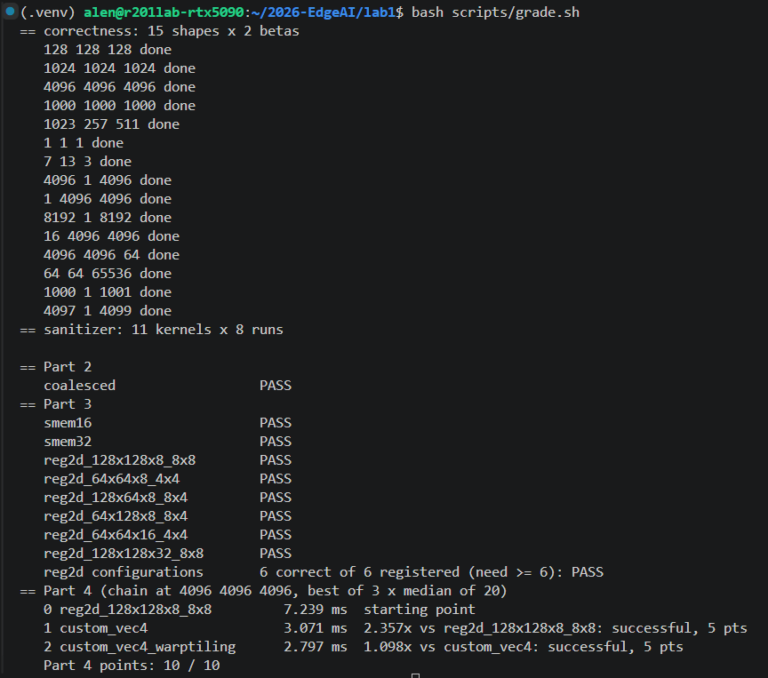

圖 4-1：三個 kernel，4096³：`grade.sh` 的計算時間、相對前一步加速比，以及 correctness 與 sanitizer 驗證結果。

#### vec4：降低載入指令與 shared-store 成本

`custom_vec4` 將 A、B tile 的搬移改為 float4，每次載入四個連續 FP32 元素。A 的四個值分別寫入轉置的 As，B 則以 float4 寫入 Bs；outer-product 計算與 C 的 scalar stores 維持相同。4096³ 的 Nsight Compute 數據如下：

| 指標 | reg2d | vec4 |
| --- | ---: | ---: |
| Global-load instructions／requests | 34,078,720 | 8,912,896 |
| Global-load sectors | 150,994,944 | 150,994,944 |
| Global-load bytes | 4,831,838,208 | 4,831,838,208 |
| Shared-store wavefronts | 150,994,944 | 50,331,648 |
| Shared-store bank conflicts | 117,440,512 | 16,777,216 |
| Warp cycles／issued instruction | 13.89 | 6.54 |

**載入指令成本降低。** L1/TEX 表格中的 global-load sectors 與 bytes 相同，但指令數從 **34,078,720 降至 8,912,896**，減為約 **1/3.824**。float4 讓每條指令搬移更多元素，因此處理相同資料交易量所需的載入指令明顯減少。

**Shared-memory 寫入更有效率。** 向量化搬移也改變了每個 thread 的 tile 載入分工與 shared-memory 寫入分布。Shared-store wavefronts 從 **150,994,944 降至 50,331,648**，減為 **1/3**；bank conflicts 從 **117,440,512 降至 16,777,216**，減為 **1/7**。這使 tile 寫入 shared memory 所需的處理工作減少。

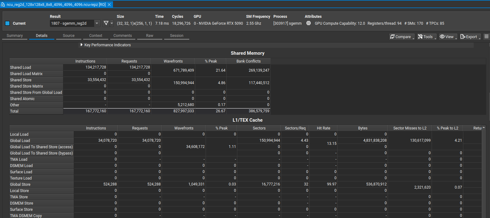

圖 4-2：reg2d_128x128x8_8x8，4096³：global-load 指令量與 shared-store wavefronts、bank conflicts。

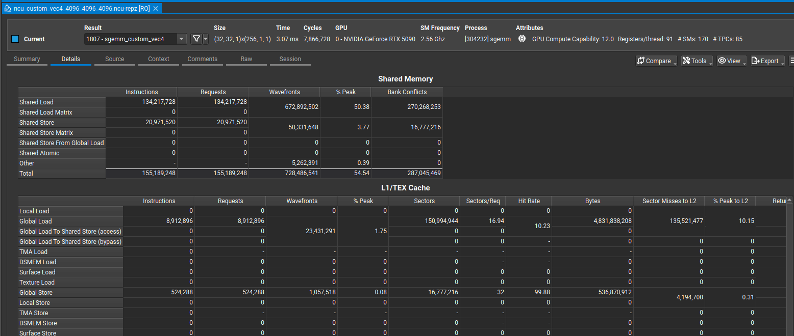

圖 4-3：custom_vec4，4096³：向量化後的 global-load 指令量與 shared-memory 存取效率；同時供下一節比較 shared-load 與 C 寫回。

**記憶體處理與等待成本降低。** Warp Cycles Per Issued Instruction 從 **13.89 降至 6.54**，與載入指令量、shared-store wavefronts 及 bank conflicts 的降低一致。這些改善共同使 vec4 相對前一步達到 **2.357×** 加速。

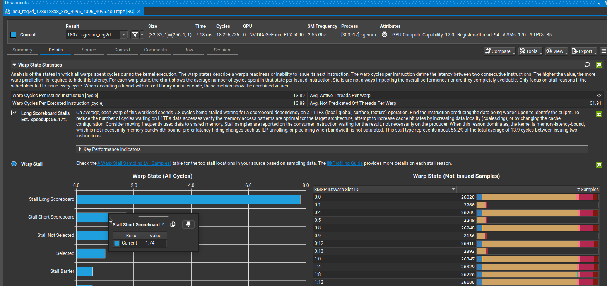

圖 4-4：reg2d_128x128x8_8x8，4096³：warp cycles／issued instruction 與各項 stall。

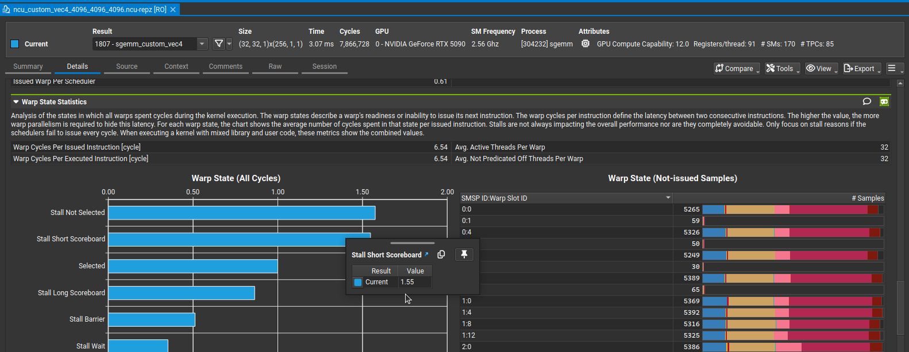

圖 4-5：custom_vec4，4096³：降低後的 warp cycles／issued instruction；Short Scoreboard 同時供下一節比較。

#### vec4＋warp tiling：改善 shared-load 與 C 寫回效率

`custom_vec4_warptiling` 保留 float4 tile 搬移與原有計算流程，將每個 warp 的輸出範圍安排為 **32×64 outputs**。透過重新分配 lanes 負責的輸出座標，改善 shared-memory 讀取與 C 寫回的位址分布。相對 vec4，其加速比為 **1.098×**。

| 指標 | vec4 | vec4＋warp tiling |
| --- | ---: | ---: |
| Shared-load instructions | 134,217,728 | 134,217,728 |
| Shared-load bank conflicts | 270,268,253 | 1,360,204 |
| Shared-load wavefronts | 672,892,502 | 404,036,739 |
| Global-store requests | 524,288 | 524,288 |
| Global-store sectors | 16,777,216 | 8,388,608 |
| Global-store sectors/request | 32 | 16 |
| Short Scoreboard（cycles／issued instruction） | 1.55 | 1.10 |
| Warp cycles／issued instruction | 6.54 | 5.95 |

**Shared-memory 讀取更有效率。** 兩版的 shared-load 指令數同為 **134,217,728**，但 warp tiling 的 bank conflicts 從 **270,268,253 降至 1,360,204**，減少 **99.50%**；wavefronts 從 **672,892,502 降至 404,036,739**，減少 **39.96%**。同樣的載入指令需求使用更少 wavefronts 完成，降低 bank conflicts 帶來的序列化處理成本。

**C 寫回更集中。** Global-store requests 同為 **524,288**，sectors 從 **16,777,216 降至 8,388,608**，sectors/request 從 **32 降至 16**。warp/lane 分工使同一條寫回指令的位址更集中，將相同輸出需求所需處理的 sectors 減半。

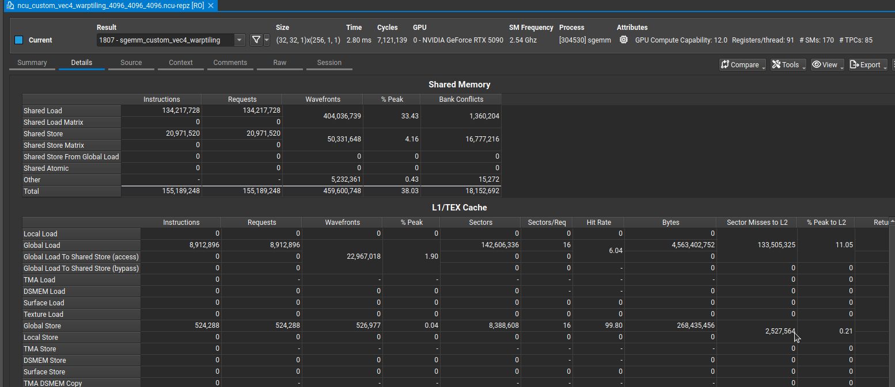

圖 4-6：custom_vec4_warptiling，4096³：shared-load bank conflicts、wavefronts 與 global-store sectors/request；與圖 4-3 比較。

**等待時間縮短。** Short Scoreboard 從 **1.55 降至 1.10 cycles／issued instruction**，Warp Cycles Per Issued Instruction 從 **6.54 降至 5.95**。shared-memory 讀取與 C 寫回效率的改善，降低記憶體處理與資料相依等待成本，使加入 warp tiling 後的 kernel 進一步加速。

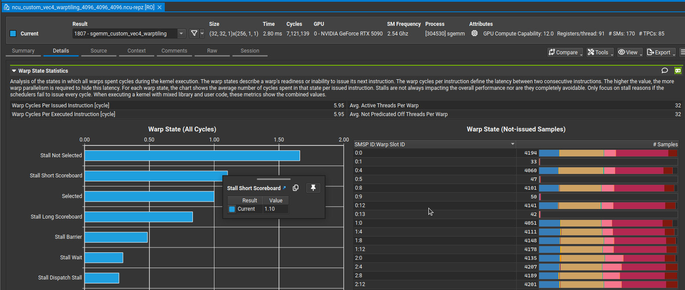

圖 4-7：custom_vec4_warptiling，4096³：Short Scoreboard 與 warp cycles／issued instruction；與圖 4-5 比較。
