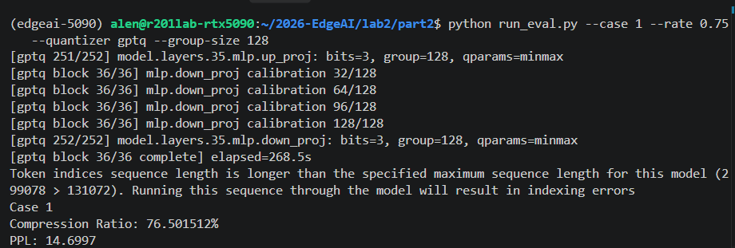
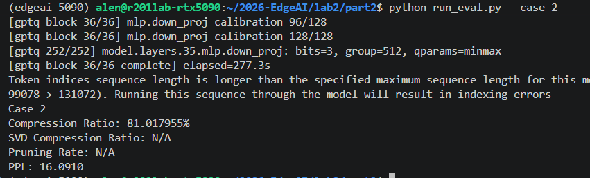
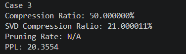

# Part 2：LLM Compression Report

## 實驗設定

我以 Qwen3-4B 為壓縮對象，四個 Case 都從相同的原始模型開始處理。壓縮範圍涵蓋 36 個 decoder blocks 中的 `q_proj`、`k_proj`、`v_proj`、`o_proj`、`gate_proj`、`up_proj` 與 `down_proj`，共 252 個 Linear layers。Attention 的四種 projection 與 MLP 的三種 projection 都包含在內，embedding 與 `lm_head` 維持原始設定。

所有 PPL 都透過作業提供的 `run_eval.py` 評估，使用 WikiText-2 test split，評估序列長度為 2048。壓縮率依目標 Linear layers 的實際儲存量計算，包含壓縮權重、量化參數與必要的 metadata：

$$
\text{Compression Ratio}=1-\frac{\text{Compressed Size}}{\text{Original Size}}.
$$

校正資料使用 WikiText-2 train split，隨機種子設為 0，抽取 128 個長度為 2048 的 token 序列。校正過程收集各層輸入的統計量，供 GPTQ、SVD whitening 與 SparseGPT 使用，整個壓縮流程不進行 fine-tuning。

## Case 1

### Compression Strategy

我使用 GPTQ 搭配混合位寬量化，將 Attention 的 `q_proj`、`k_proj`、`v_proj`、`o_proj` 設為 4-bit，MLP 的 `gate_proj`、`up_proj`、`down_proj` 設為 3-bit，group size 統一設為 128。這個配置讓 Attention 保留較細的量化間隔，並透過 MLP 的 3-bit 權重降低整體儲存量。

GPTQ 使用校正輸入建立 Hessian 近似，每量化一個權重 column，就將量化誤差補償至尚未處理的 columns，以減少 Linear 輸出的重建誤差。量化範圍使用 min/max，damping 設為 Hessian 對角線平均值的 0.01 倍，block size 為 128。

我依照 q/k/v → o → gate/up → down 的順序逐組壓縮，每組處理後重新收集後續組的輸入，讓校正反映前面已量化層的影響。最終權重以低位元 codes 打包儲存，推論時逐層反量化並執行 Linear 運算。

### Result

| 指標 | 結果 | 作業要求 |
| --- | ---: | ---: |
| Compression Ratio | 76.501512% | > 75% |
| PPL | 14.6997 | < 15 |

### Analysis

Case 1 的設計邏輯是先分配 bit width 以達到儲存目標，再透過 GPTQ 降低量化對模型輸出的影響。全部使用 4-bit 時，單看權重的理想壓縮率為 75%，加入量化參數後還會下降。將 MLP 改為 3-bit，讓最終壓縮率達到 76.501512%，符合嚴格大於 75% 的條件。

我固定 Attention 4-bit、MLP 3-bit 與 group size 128，比較三種量化方式：

| 方法 | Compression Ratio | PPL |
| --- | ---: | ---: |
| RTN + min/max | 76.501512% | 21.6025 |
| RTN + MSE clipping | 76.501512% | 19.4685 |
| GPTQ + min/max | 76.501512% | 14.6997 |

RTN 直接將權重捨入至量化格點。MSE clipping 則在原始範圍的 100% 至 50% 之間搜尋 21 個候選範圍，選出權重重建誤差最小的設定，使 PPL 從 21.6025 降至 19.4685。GPTQ 進一步利用輸入統計補償誤差，將 PPL 降至 14.6997，比 MSE clipping 再降低 4.7687。

## Case 2

### Compression Strategy

我將全部 252 個目標 Linear layers 設為 3-bit，使用 GPTQ 量化，group size 調整為 512。量化範圍使用 min/max，校正樣本數、序列長度、damping 與 block size 沿用 Case 1 的設定。

為了達到 81% 的壓縮率，我同時精簡量化參數的儲存方式，降低 scale 的儲存成本，並將 zero point 以 3-bit 打包。每 512 個權重共用一組量化參數，讓這部分的成本分攤到更多權重上。

GPTQ 在決定權重 codes 時使用實際儲存的 scale 值進行誤差補償，讓壓縮時的重建值與推論使用的重建值一致。最終模型保留打包後的 3-bit 權重及必要的量化參數。

### Result

| 指標 | 結果 | 作業要求 |
| --- | ---: | ---: |
| Compression Ratio | 81.017955% | ≥ 81% |
| PPL | 16.0910 | < 20 |

此配置同時達到壓縮率與 PPL 的要求。

### Analysis

3-bit 權重本身的理想壓縮率為 81.25%，與作業要求的 81% 相當接近，因此量化參數的儲存成本直接影響能否達標。我將 group size 提高至 512，並精簡 scale 與 zero point 的表示，將最終壓縮率維持在 81.017955%。

與 Case 1 相比，Case 2 的壓縮率提高約 4.5164 ，PPL 從 14.6997 上升至 16.0910。全部使用 3-bit 減少了 Attention 的量化格點，而較大的 group size 也讓更多權重共用同一組量化範圍。這些調整提高儲存效率，同時增加量化誤差，使用 GPTQ 的逐步補償讓 PPL 仍低於 20。

Case 2 的結果說明，達到高壓縮率需要一起安排權重 bit width、group size 與量化參數的儲存方式。這三項設定搭配 GPTQ，讓模型在壓縮 81% 的目標層儲存量的情況下，維持 16.0910 的 PPL。

## Case 3

### Compression Strategy

我先對全部目標 Linear layers 進行 activation whitening SVD，再量化部分因子列，以兩階段方式完成 SVD 壓縮率至少 20%、整體壓縮率等於 50% 的要求。

第一階段使用校正輸入建立 Gram matrix，加入對角線平均值 0.0001 倍的 damping，再透過 Cholesky 分解取得 whitening 所需的矩陣。接著對經輸入統計加權的權重進行 SVD，保留前 r 個奇異值方向，將原始權重近似為兩個較小的因子：

$$
W\approx AB,\qquad
A\in\mathbb{R}^{O\times r},\quad
B\in\mathbb{R}^{r\times I}.
$$

其中 I、O 分別為原始 Linear 的輸入與輸出維度。各層 rank 依因子儲存預算配置，SVD 階段以減少 21% 的權重儲存量為目標。推論時依序執行兩個較小的 Linear。

第二階段採用混合精度儲存因子，將部分尾端列量化為 8-bit，其餘列維持原始精度。量化使用 RTN、group size 128 與 MSE clipping，在 100% 至 50% 的範圍內搜尋 21 個候選。量化列數依實際儲存成本分配，再調整列數組合，使最終儲存量精確等於原始目標層的一半。

### Result

| 指標 | 結果 | 作業要求 |
| --- | ---: | ---: |
| SVD Compression Ratio | 21.000011% | ≥ 20% |
| Overall Compression Ratio | 50.000000% | = 50% |
| PPL | 20.3554 | < 50 |

兩個壓縮階段的實際儲存量如下：

| 階段 | 儲存量（bytes） |
| --- | ---: |
| 原始目標權重 | 7,266,631,680 |
| SVD 後、因子量化前 | 5,740,638,208 |
| 因子量化後的最終表示 | 3,633,315,840 |

SVD Compression Ratio 由因子量化前的儲存量計算；Overall Compression Ratio 由最終表示計算。此配置達到三項作業要求。

### Analysis

Whitening 將校正輸入的統計量納入低秩近似，使 SVD 保留的方向更符合 Linear 的實際輸入分布。截斷時優先保留對加權輸出重建較重要的奇異值方向，讓 rank 的選擇直接對應模型運算所使用的特徵。

SVD 階段先將儲存量降至原始權重的約 79%，因子量化再將最終儲存量降至 50%。將兩階段分開配置，讓 SVD 的壓縮要求與整體儲存目標都能達成。部分列保留原始精度，也讓我能以列為單位調整量化程度，精確控制最終大小。

Case 3 的 PPL 為 20.3554，高於 Case 1 與 Case 2。低秩分解會移除部分奇異值方向，因子量化則進一步改變保留因子的數值，兩種誤差共同影響模型輸出。這也說明壓縮方法本身對品質有直接影響：Case 3 的整體壓縮率較低，仍因低秩截斷產生較高的 PPL。Whitening 與混合精度因子儲存讓這個組合達到指定大小，並將 PPL 維持在 50 以下。

## Case 4

### Compression Strategy

我沿用 SparseGPT 的逐層校正與誤差補償流程，將剪枝方式改為每列連續 4 個權重剪除 1 個，壓縮全部 252 個目標 Linear layers。保留的權重使用 2-bit 量化，group size 為 64，量化範圍使用 min/max。校正樣本數、序列長度、damping 與 block size 沿用 Case 1。

在每個量化 group 中，我以 `w² / R[j,j]²` 評估移除成本，於每列的每 4 個權重中選擇分數最低的位置；R 為逆 Hessian 的上三角 Cholesky 因子。每處理一個 column，就共同決定剪枝與量化結果，並補償後續 columns 的誤差。被剪除的位置固定為零。

最終每 4 個權重只儲存 3 個存活值與 2-bit 的剪除位置，不保存被剪除位置的 code。每個量化 group 另存 FP16 scale 與 2-bit zero point，並計入每層 32 bytes 的 metadata。推論時暫時重建完整權重。

依助教 QA，剪枝率須以實際儲存縮減判定。量化前保留原始 FP16 精度，每 4 個權重由 64 bits 減為 `3×16+2=50 bits`，理論剪枝壓縮率為 21.875%。實際帳本再計入位置索引、metadata 與 bias；剪除元素比例另行記錄。

### Result

| 指標 | 結果 | 作業要求 |
| --- | ---: | ---: |
| Pruning Compression Ratio（量化前，含位置索引與 metadata） | 21.874889% | ≥ 20% |
| 剪除元素比例 | 25.000000% | 另行記錄 |
| Overall Compression Ratio | 85.742077% | ≥ 85% |
| PPL | 41.3809 | < 50 |

原始目標層共 7,266,631,680 bytes，量化前的稀疏表示為 5,677,064,064 bytes，最終剪枝加量化表示為 1,036,070,784 bytes。實際剪除 908,328,960 個原始非零權重，分母為 3,633,315,840 個目標權重。252 個目標層各自的量化前稀疏表示也都達到 20% 以上的儲存縮減。

本次結果由完整 Qwen3-4B、WikiText-2 test 的官方評估程序取得，環境為 RTX 5090、Python 3.11、torch 2.7.0+cu128。原始數據與逐層帳本見 `results/case4_sparse34_g64.json`，終端輸出見同名 `.stdout.txt`。尚未在 T4／torch 2.5.1+cu121 實機驗證。舊 `pic/case4.png` 屬於先前的非結構化剪枝配置，不作為這次結果。

### Analysis

剪除 25% 元素後，還要保存剪除位置，因此剪枝本身的實際儲存縮減為 21.874889%。這個差別說明，權重歸零比例不能直接當成壓縮率。稀疏表示提供可確認（confirm）的儲存帳本，計算的推理（logic）是先固定原始精度比較剪枝前後，再以最終 buffers 計算整體壓縮率。

接上 2-bit 量化後，每 4 個原始權重需 `3×2+2=8 bits`，平均每個權重為 2 bits；再加上 group64 的 scale 與 zero point，平均為 `2+(16+2)/64=2.28125 bits`。因此含位置索引後，整體壓縮率仍為 85.742077%，PPL 為 41.3809，符合本次三項門檻。

舊的 20% 非結構化剪枝配置雖然 PPL 為 42.1455、整體壓縮率相同，卻仍保存所有位置的 codes，剪枝本身沒有省下儲存。新版同時改變剪枝比例與位置限制，因此兩組 PPL 的差異不能單獨歸因於剪枝比例。

## Overall Conclusion

| Case | 主要策略 | Compression Ratio | PPL | 額外要求 |
| --- | --- | ---: | ---: | --- |
| 1 | GPTQ，Attention 4-bit／MLP 3-bit | 76.501512% | 14.6997 |  |
| 2 | GPTQ，全部 3-bit，精簡量化參數儲存 | 81.017955% | 16.0910 | |
| 3 | Whitening SVD + 部分因子列 8-bit 量化 | 50.000000% | 20.3554 | SVD CR 21.000011% |
| 4 | SparseGPT，3:4 稀疏剪枝 + 2-bit 量化 | 85.742077% | 41.3809 | 剪枝儲存縮減 21.874889% |

我透過不同的配置完成四個 Case 的壓縮率、PPL 與指定方法要求。Case 1 以混合位寬保留較細的 Attention 權重表示，取得最低的 PPL；Case 2 進一步縮小權重位寬與量化參數的儲存成本，將壓縮率提高至 81% 以上；Case 3 透過 whitening SVD 與因子量化，完成低秩分解及精確儲存預算的要求；Case 4 則以剪枝與 2-bit 量化取得最高壓縮率。

Case 1 的方法對照顯示，GPTQ 能在相同儲存量下顯著降低 PPL，輸入統計與誤差補償是保留模型品質的關鍵。Case 2 與 Case 4 進一步顯示，量化參數的儲存成本會影響整體壓縮率，group size 必須配合位寬安排。Case 3 則呈現低秩截斷帶來的影響，保留多少儲存量與保留哪些特徵方向，都會左右模型品質。

若優先維持較低的 PPL，我會選擇 Case 1；若要求最高壓縮率，我會選擇 Case 4。綜合儲存節省與模型品質，我認為 Case 2 最有效：它將目標層儲存量減少 81.017955%，PPL 為 16.0910，相較 Case 1 進一步節省空間，也保留了明顯優於 Case 4 的模型品質。

## Summary

這次實驗讓我掌握從 bit width 配置、量化參數儲存到輸入感知誤差補償的完整流程。設計壓縮方法時，我需要同時考慮權重如何表示、哪些資訊會被移除，以及這些改變如何影響 Linear 的輸出。GPTQ、whitening SVD 與 SparseGPT 都利用輸入統計安排壓縮，但分別透過量化補償、低秩近似與剪枝選擇達成不同目標。

我也學到將儲存預算拆開安排的重要性。Case 2 透過位寬、group size 與量化參數的共同調整達到 81% 的壓縮要求；Case 3 先安排 SVD rank，再決定因子量化列數，精確達到 50%；Case 4 則將剪枝與量化放入同一個補償流程，完成更高的壓縮目標。綜合四組結果，我會優先採用 Case 2 的 3-bit GPTQ 作為兼顧儲存效率與模型品質的策略。
