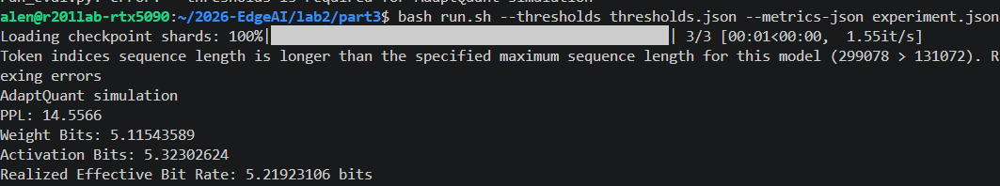

# Part 3：Calibration-Free Quantization Reproduction Report

## Method

我在這部分重現 AdaptQuant，使用 fake quantization 模擬低位元浮點格式，並在 Qwen3-4B 上評估模型品質。量化對象為 36 個 decoder blocks 中的 `q_proj`、`k_proj`、`v_proj`、`o_proj`、`gate_proj`、`up_proj` 與 `down_proj`，共 252 個 Linear layers，涵蓋這些層的權重與輸入 activation。

我先使用 Llama-3.1-8B 與 WikiText-2 train split 的一段 2048 tokens，離線推導七種 projection 各自的 weight 與 activation 閾值，再將閾值固定套用至 Qwen3-4B。這個配置的設計邏輯（logic）是讓格式選擇規則由 reference model 決定，Qwen3-4B 直接依固定規則進行量化，完成 target-model calibration-free PTQ。

矩陣以 16×32 的 tile 為單位，根據每個 tile 的最大絕對值與 RMS 比值，從 MXFP4、MXFP6、MXFP8 中選擇格式。每個 tile 共用格式選擇結果，每列的 32 個元素則各自共用一個 8-bit E8M0 scale。權重在替換 Linear 時量化一次；activation 在每次 forward 時，依當次輸入計算 tile 統計量與 scale，再使用固定閾值選擇格式。

量化後的值以浮點數承載低位元格式的重建結果，接著執行 Linear 運算。我透過 `run_eval.py` 使用 WikiText-2 test split 評估 PPL，序列長度為 2048，同時統計評估過程中 activation 的實際格式分配。整個目標模型處理流程沿用固定閾值，不進行參數訓練。

## Result

| 指標 | 實測結果 |
| --- | ---: |
| PPL | 14.5566 |
| Weight Bits | 5.11543589 |
| Activation Bits | 5.32302624 |
| Realized Effective Bit Rate | 5.21923106 bits |

平均有效位寬包含元素本身的格式位元與 scale 成本。每 32 個元素共用一個 8-bit scale，完整 block 的 scale 成本為每個元素 0.25 bits，因此 MXFP4、MXFP6、MXFP8 分別對應 4.25、6.25、8.25 bits 的有效位寬。

我先分別加總 weight 與 activation 的格式位元和 scale 位元，再除以各自的有效元素數。Weight 每層計算一次；activation 累計正式評估中各次 forward 進入量化 Linear 的輸入元素，採元素數加權。計算如下：

$$
\begin{aligned}
\text{Weight Bits}
&=\frac{17{,}677{,}665{,}280+908{,}328{,}960}{3{,}633{,}315{,}840}
\approx 5.11543589,\\
\text{Activation Bits}
&=\frac{1{,}453{,}870{,}491{,}648+71{,}647{,}100{,}928}{286{,}588{,}403{,}712}
\approx 5.32302624.
\end{aligned}
$$

上述兩個分子的第一項為元素格式位元，第二項為 scale 位元。最後依作業定義取兩者平均：

$$
\text{Realized Effective Bit Rate}
=\frac{5.11543589+5.32302624}{2}
\approx 5.21923106\leq 5.3\text{ bits}.
$$

## Observation and Discussion

我先觀察 weight 與 activation 的格式分配，以下比例依有效元素數加權：

| 對象 | MXFP4 | MXFP6 | MXFP8 |
| --- | ---: | ---: | ---: |
| Weight | 56.7321% | 43.2641% | 0.0038% |
| Activation | 46.3487% | 53.6513% | 0.0000% |

權重有超過一半使用 MXFP4，其餘主要使用 MXFP6，讓平均位寬維持在 5.11543589 bits。Activation 使用 MXFP6 的比例達 53.6513%，因此平均位寬提高至 5.32302624 bits。兩者的 scale 成本相同，平均位寬的差異直接反映格式分配比例。聯合計算後，整體仍低於 5.3 bits，讓權重與 activation 能共同分配精度預算。

混合格式讓不同數值分布的 tiles 使用不同精度。統計量較低的 tiles 使用 MXFP4，以較少位元表示；統計量較高的 tiles 使用 MXFP6 或 MXFP8，提供較細的數值表示或較大的動態範圍。這次權重只有 0.0038% 使用 MXFP8，activation 全部使用 MXFP4 與 MXFP6，顯示這組固定閾值主要透過 4-bit 與 6-bit 的組合安排精度。

不同 projection 的 activation 分配也有明顯差異：

| Projection | MXFP4 比例 | MXFP6 比例 | 含 scale 的平均位寬 |
| --- | ---: | ---: | ---: |
| `q_proj` | 83.7926% | 16.2074% | 4.57414722 |
| `k_proj` | 74.1936% | 25.8064% | 4.76612863 |
| `v_proj` | 87.9154% | 12.0846% | 4.49169231 |
| `o_proj` | 40.3919% | 59.6081% | 5.44216257 |
| `gate_proj` | 47.4998% | 52.5002% | 5.30000416 |
| `up_proj` | 47.4998% | 52.5002% | 5.30000416 |
| `down_proj` | 20.1311% | 79.8689% | 5.84737797 |

`q_proj`、`k_proj`、`v_proj` 的 activation 主要使用 MXFP4，`down_proj` 則有 79.8689% 使用 MXFP6，平均位寬達 5.84737797 bits。這個差異反映各 projection 的輸入分布與固定閾值共同決定了精度分配。`down_proj` 接收經過 MLP 中間運算後的 activation，其 tiles 在本次評估中更常落入 MXFP6 的選擇區間，因此分配到較高的平均位寬。`gate_proj` 與 `up_proj` 共用相同輸入與相同 activation 閾值，兩者的格式比例與平均位寬也一致。

數值實作的重點在於格式選擇與 scale 的粒度。格式依 16×32 tile 決定，scale 則由每列 32 個元素的數值範圍決定；兩者分開處理，才能得到對應的重建值與位寬成本。共享 scale 讓同一 block 的最大值影響整組元素的縮放，幅度較小的值會受到量化間隔影響；將 scale 成本納入計算，也讓位寬結果完整反映格式所需的表示成本。

另一個實作重點是浮點格式的捨入。MXFP4、MXFP6 與 MXFP8 各有自己的指數與尾數配置，捨入間隔會隨數值大小變化。我依各格式處理 nearest-even rounding、subnormal 與飽和邊界，將輸入映射至對應的可表示值。有限的量化格點、block 共享 scale 與格式邊界共同形成重建誤差，這些誤差會隨多層運算影響最終的 token 預測。

本次將 Llama-3.1-8B 推導的閾值固定套用至 Qwen3-4B，格式比例會隨目標模型實際產生的數值分布改變。這項設計讓目標模型直接使用既有閾值完成量化，並取得 PPL 14.5566。與作業基準比較時，reference 片段、閾值推導設定與數值模擬細節都是影響重現結果的因素；本次配置在平均 5.21923106 bits 下達到 PPL ≤ 15 的品質目標。

後續我會優先改善 activation 量化的執行效率。權重只需處理一次，activation 則在每次 forward 重複進行 tile 統計、格式選擇、捨入與重建。將這些運算進一步向量化、減少中間張量配置，並調整 tile 分批處理的大小，能降低這段流程的運算與暫存成本。這些調整沿用既有閾值與數值規則，讓改善方向集中在實作效率。

這次實驗讓我掌握如何把固定閾值套用到不同模型，以及如何同時計算 weight 與 activation 的有效位寬。格式分配決定元素精度，共享 scale 決定局部縮放，而兩個 operand 的元素加權平均共同決定最終位寬。將這些部分接到同一次 PPL 評估後，我能清楚連結量化設定、實際精度分配與模型品質。

[your words：請填入實作時最有感的困難、解決過程與心得。]
